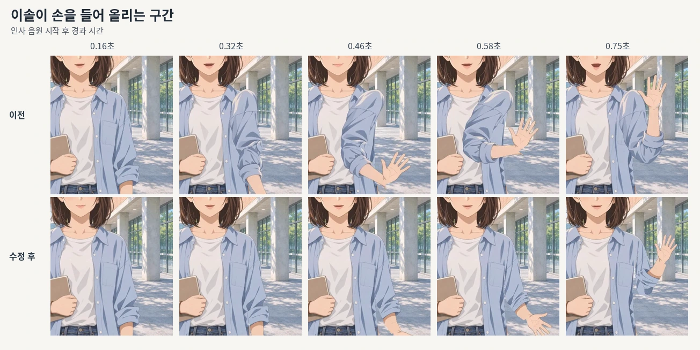
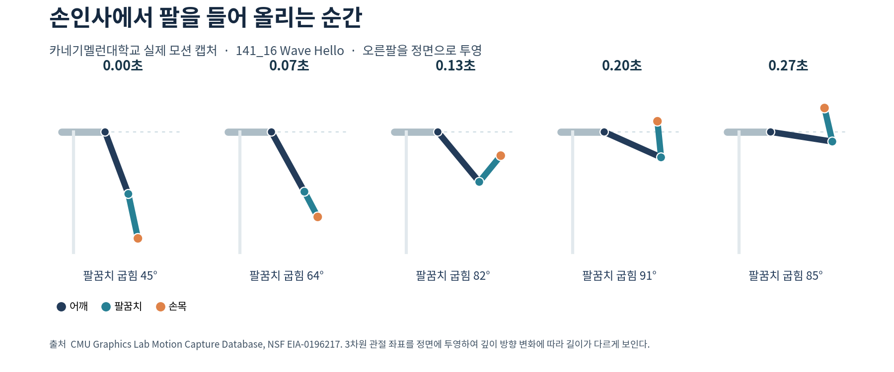

# 이솔이 손을 들어 인사하는 구간

이솔의 기존 인사에서는 손이 몸 옆을 지나자마자 손바닥이 정면을 향했다. 이때 손목이 소매에 대해 99° 가까이 꺾이고 팔꿈치도 펴지는 지점을 넘어 반대쪽으로 접혔다. 팔과 손이 화면에서 서로 닿아 있어도 정지 화면에서 팔이 부러진 것처럼 보였던 이유다.

위쪽은 직전 배포본, 아래쪽은 현재 웹 앱이다. 양쪽 모두 인사 음원이 시작한 때를 기준으로 같은 시각의 화면을 잘랐다. 팔이 다시 내려오는 모습까지 보려면 인사 영상을 재생한다. [이솔의 인사 영상](isol-greeting.mp4)

## 기준 동작

| 자료 | 구간에서 관찰한 움직임 |
| --- | --- |
| Live2D의 접객용 Haru | 공식 Web Samples에서 모델과 모션을 받아 Cubism Framework로 `TapBody` 네 편의 42개 파라미터를 30fps, 591프레임에 걸쳐 읽었다. `m06`의 오른팔 B 채널은 1.67초, 손목 채널은 1.90초에 정점에 이른다. `m26`에서 고개와 몸통의 숙임 정점도 각각 3.50초와 3.90초로 다르다. [모델](https://www.live2d.com/en/learn/sample/haru-receptionist/) · [m06](https://github.com/Live2D/CubismWebSamples/blob/b1de66b0b1f1cb881d95fb6158622aeb6a2827bd/Samples/Resources/Haru/motions/haru_g_m06.motion3.json) · [m26](https://github.com/Live2D/CubismWebSamples/blob/b1de66b0b1f1cb881d95fb6158622aeb6a2827bd/Samples/Resources/Haru/motions/haru_g_m26.motion3.json) |
| Live2D의 Haru 자세 전환 시연 | 제작사가 렌더링한 별도 Haru 모델이 팔을 내린 자세에서 두 팔을 앞으로 모은다. 2.96초 부근에는 두 자세의 팔 그림이 함께 보인다. 이솔의 소매를 비교할 때 어깨 가장자리, 안쪽 주름, 손 윤곽이 겹쳐 보이는지도 확인했다. [공식 시연](https://docs.live2d.com/en/cubism-sdk-tutorials/attention-changepose/) |
| CMU Graphics Lab의 사람 손인사 `141_16 Wave Hello` | 보정용 첫 자세 다음부터 120fps로 오른팔을 살폈다. 0.00초, 0.13초, 0.20초의 팔꿈치 굽힘은 45°, 82°, 91°였다. 손목은 어깨 아래에서 출발해 0.20초쯤 어깨 높이를 지나며 아래팔 방향도 함께 변한다. 이솔이 팔을 조금 낮게 드는 인사에 이 순서를 참고했다. [원본 모션 목록](https://github.com/una-dinosauria/cmu-mocap/blob/09a07f54f3bbb58797325f009282d0b2048a2871/cmu-mocap-index-text.txt#L2759) · [모션 데이터](https://github.com/una-dinosauria/cmu-mocap/blob/09a07f54f3bbb58797325f009282d0b2048a2871/data/141/141_16.bvh) |
| KalidoKit 제작자의 실시간 캐릭터 시연 | 웹캠과 VRM 아바타를 함께 보여 준다. 7.2초에는 팔이 내려가 있고, 7.4~7.6초에 위팔과 팔꿈치가 올라간 뒤 7.8초에 손바닥이 화면 위쪽으로 들어온다. 9.4~9.8초에는 팔꿈치가 내려가도 한 손은 얼굴 옆에 남는다. [제작자 시연](https://github.com/yeemachine/kalidokit/blob/6437947da2f889fdf241b84745b53082f9e881a8/docs/kalidokit_glitch.gif) |

이 도표는 CMU Graphics Lab Motion Capture Database의 관절 좌표로 작성했다. 팔꿈치 굽힘은 3차원 각도이고 그림은 정면 투영이다. 데이터 수집 지원은 NSF EIA-0196217이다. [CMU 데이터 출처와 사용 조건](https://github.com/una-dinosauria/cmu-mocap/blob/09a07f54f3bbb58797325f009282d0b2048a2871/READMEFIRST.txt#L168-L182)

오픈소스 three.js의 `RobotExpressive`에 들어 있는 `Wave` 클립에서는 팔꿈치가 약 0.4초에 올라간 뒤 1.4초까지 비슷한 위치에 머물고, 손은 그 사이 작은 호를 반복한다. [CC0 원본 애니메이션](https://github.com/mrdoob/three.js/tree/940edbc5bd982d1cd73721d4c156f70a1806bd10/examples/models/gltf/RobotExpressive)

오픈소스 Rive와 Godot의 두 관절 IK 구현은 팔 길이와 팔꿈치가 굽는 방향을 함께 다룬다. 이솔의 원화 리깅에서는 원래 어깨·팔꿈치·손목 좌표로 굽는 방향을 정했다. 손은 아래팔의 변환을 이어받는다. [Rive 구현](https://github.com/rive-app/rive-runtime/blob/c355fea551408e006cd62e2ff48eaf2b671be98f/src/constraints/ik_constraint.cpp#L112-L180) · [Godot 구현](https://github.com/godotengine/godot/blob/4c311cbee68c0b66ff8ebb8b0defdd9979dd2a41/scene/resources/2d/skeleton/skeleton_modification_2d_twoboneik.cpp#L150-L189)

## 이솔의 원화에 적용한 움직임

- 팔을 내린 원화에서 어깨와 팔꿈치의 주름을 짚고, 화면 아래의 손목 위치는 소맷단과 피부의 방향을 연장해 잡았다. 같은 좌표에서 출발하므로 인사를 시작하는 첫 프레임에도 원래 소매의 윤곽이 이어진다.
- 먼저 팔꿈치가 몸 옆에서 굽고, 위팔이 조금 앞으로 나온다. 아래팔이 카메라를 향할 때는 화면에 보이는 길이가 줄어든다. 손바닥은 들어 올리는 후반에 펴지고, 손등과 네 손가락이 차례로 흔들린다. 팔을 내리거나 도중에 다른 동작을 선택할 때도 팔꿈치는 같은 방향으로 펴진다.
- 하늘색 셔츠는 원화의 소매 한 장을 쓴다. 위팔과 아래팔 사이에서 주름을 가로지르는 삼각형 50개가 두 뼈의 회전을 나눠 받는다. 접힌 소맷단과 손은 같은 손목 좌표를 쓴다. [소매 변형](../../apps/web/src/IsolGreetingSleeve.tsx) · [관절의 위치와 회전](../../apps/web/src/isol-greeting-pose.ts)

브라우저에서 인사·가리키기·동작 전환을 재생하며 측정했을 때 이솔의 손목 회전은 약 30° 이내였다. 가로 360 기준으로 올라갈 때 손끝은 최대 x=351, 내려올 때는 x=354에 닿는다. 인사 중간과 팔을 든 자세에서 화면에 칠해진 위팔·팔꿈치·아래팔·손목 사이의 빈틈은 0픽셀이었다. 데스크톱과 휴대전화 크기의 브라우저에서는 인사 시작부터 소매가 한 겹으로 표시되는지도 매 프레임 검사한다. [자세 측정](../../scripts/portrait_proportions.py) · [재생 검사](../../scripts/react_smoke.py)
