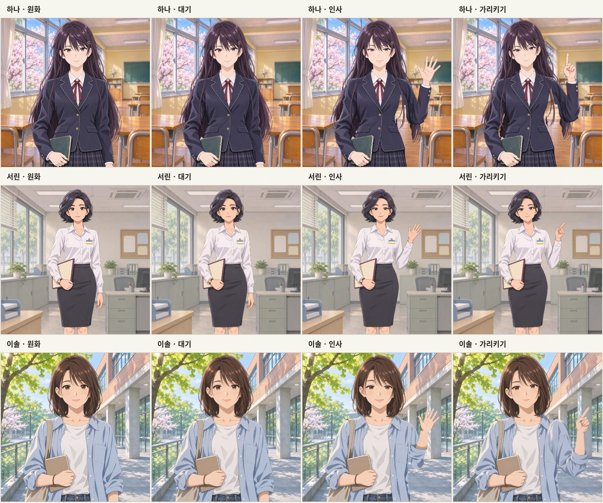

# 대화 캐릭터

**개인 비서 → 아바타 종류**에서 인물을 바꿀 수 있다. 대기 중에 인물을 바꾸면 대화 기록은 유지된다. 답변을 생성하거나 읽는 동안에는 아바타 선택이 잠긴다. 답변이 끝나거나 중지되면 다음 인물을 선택할 수 있다. 성인 캐릭터와 대화하는 **가상 소개팅**에는 서린과 이솔이 등장한다. 하나를 선택한 채 소개팅으로 이동하면 서린이 나타나고, 캐릭터 선택을 바꾸지 않고 개인 비서로 돌아오면 하나가 다시 나타난다.

| 캐릭터 | 인물 디자인 |
|---|---|
| 하나 · 17세 고등학생 | 햇빛이 드는 교실에서 추리 소설을 즐겨 읽는다. 밝은 복숭앗빛 피부와 짙은 자줏빛 긴 머리, 남색 블레이저와 흰 셔츠, 자주색 리본과 체크 치마를 그렸다. [하나 원화](hana-original.png) |
| 서린 · 30대 직장인 | 햇빛이 드는 사무실에서 팀 일정을 맡고 있다. 웨이브 단발에 흰 칼라 셔츠와 무릎선 차콜 펜슬스커트를 입고, 셔츠 가슴에 사원증을 달았다. 한 손에는 회의 서류철을 든다. [서린 원화](seorin-original.webp) · [눈썹 움직임 비교](seorin-brow-motion.mp4) |
| 이솔 · 20대 대학생 새내기 | 볕이 드는 캠퍼스 길. 밤색 단발을 한쪽 귀 뒤로 넘긴 이솔은 흰 티셔츠 위에 하늘색 셔츠를 걸치고, 캔버스 가방을 어깨에 멘 채 노트를 들고 있다. [이솔 원화](isol-original.png) |

하나와 이솔의 목소리 비교에서는 두 사람이 각각 “안녕하세요! 오늘 날씨 참 좋네요. 우리 같이 걸을까요?”를 두 번 읽는다. 이전 목소리를 들려준 뒤 0.8초 쉬고, 당시 조율한 캐릭터 음높이와 1.2배 발화 속도로 같은 말을 한 번 더 들려준다. [하나의 목소리 비교](hana-voice-comparison.mp3) · [이솔의 목소리 비교](isol-voice-comparison.mp3)

## 움직임 보기

| 캐릭터 음성 | 인사말 | 자기소개 |
|---|---|---|
| 하나 · F4 | [오늘 있었던 일 묻기](hana-greeting.mp4) | [추리 소설 이야기](hana-intro.mp4) |
| 서린 · F1 | [먼저 하고 싶은 일 묻기](seorin-greeting.mp4) | [프로젝트 일정 이야기](seorin-intro.mp4) |
| 이솔 · F2 | [그늘에서 함께 쉬자고 하기](isol-greeting.mp4) | [캠퍼스에서 그리는 노트](isol-intro.mp4) |

- 앱의 **표정·동작 미리보기**를 열고 **인사말 듣기** 또는 **내레이션 미리듣기**를 누르면 현재 웹 앱에 담긴 한국어 음원을 들을 수 있다. 마이크를 켜거나 새 답변이 시작되거나 캐릭터를 바꾸면 샘플 재생을 멈춘다.
- 서린은 말을 꺼낼 때 눈썹을 살짝 들었다 내리고, 같은 구절의 다음 강세는 고개와 입으로 표현한다. 음량과 음색은 입의 높이·폭을 정한다. 문장 사이에 쉬면 입은 닫히고, 고개와 어깨의 움직임은 서로 다른 속도로 가라앉는다.
- 캐릭터 안에서 마우스 포인터를 좌우로 옮기면 홍채가 먼저 따라간다. 고개와 몸통은 조금 늦게 움직이고, 하나의 앞머리와 양옆의 긴 머리카락은 뿌리를 중심으로 흔들리다 멈춘다.
- **인사하기**와 **가리켜 설명하기**로 어깨에서 팔을 들어 손목까지 이어지는 동작을 볼 수 있다. 고개를 숙이면 목 밑을 축으로 머리가 먼저 기울고 가슴이 뒤따른다. 인사할 때는 몸 바깥쪽에서 팔꿈치를 굽히고, 손목이 방향을 바꾼 뒤 네 손가락이 각 마디를 중심으로 조금씩 따라온다. 운영체제의 **동작 줄이기**에서는 표정과 손 모양, 음성에 맞춘 입술 움직임으로 말하는 상태를 확인할 수 있다.

### 내레이션 참고

- Live2D 접객용 캐릭터의 인사 동작과 Noto 손인사 애니메이션 프레임을 참고했다. 팔을 들어 올리는 동작과 손목으로 짧게 흔드는 동작의 타이밍을 나눴다. [Live2D 접객 모델](https://www.live2d.com/en/learn/sample/haru-receptionist/) · [Noto 손인사 프레임](https://github.com/akilluminati47/noto-animated-emoji-pack/blob/main/gif/wave_1f44b_1f3fb.gif)

- Live2D가 공개한 모모세 히요리 영상과 버튜버 에밀리아나가 소개한 VSeeFace 표정 추적 튜토리얼은 제작사·제작자가 연결한 YouTube 자료다. [히요리 공식 소개와 영상](https://www.live2d.com/learn/sample/momose-hiyori-video/) · [에밀리아나의 표정 추적 튜토리얼](https://www.youtube.com/watch?v=-Y2JyGLxuyo)
- 실제 움직임의 타이밍은 Project AIRI 제작팀이 공개한 음성 대화 시연에서 확인했다. 1분 1초대에는 입이 짧게 여러 차례 열리는 사이 고개는 한 번에 천천히 기울기를 푼다. 1분 3.72초부터 약 1초간 소리가 쉴 때는 입이 작게 다물린 채 눈이 한 번 깜박인다. 앱에서도 발음, 시선, 자세를 각각 다른 시간 간격으로 처리했다. [AIRI 제작팀의 시연 영상](https://github.com/moeru-ai/airi-docs/blob/6317834c5491589e7afc094878e911fee8636727/content/en/blog/DevLog-2025.03.20/assets/airi-demo.mp4)
- 하나는 추리 이야기를 경쾌하게 꺼내고, 이솔은 새로 들어간 대학 이야기를 밝은 해요체로 들려준다. 서린은 일정을 차분하고 또렷하게 설명한다. 위 영상은 앱의 캐릭터 미리듣기를 30fps로 담았으며 길이는 7.23–8.80초다. 웹 앱의 MP3와 영상에 담긴 AAC 음성을 다국어 Whisper small로 전사한 결과, 두 형식의 여섯 편 모두 공백과 문장부호를 제외한 한글 음절이 대본과 일치했다. 새 답변도 Supertonic 2 워커에서 같은 캐릭터별 설정으로 합성한다. [목소리와 사용 조건](sources-and-licenses.md#캐릭터-원화와-한국어-음성) · [음성 설정과 공개 발화 참고 자료](../../workers/tts-supertonic/README.md)

## 작화 참고

작품 속 인물의 얼굴이 말을 하거나 시선을 바꿀 때 어느 선이 움직이는지 살펴봤다. 앱에 쓰는 세 인물의 원화는 이 프로젝트용으로 새로 생성했다. 홍채와 눈꺼풀, 눈썹, 다문 입술을 각 원화에서 분리하고 코와 턱은 원래 위치에 두었다. 대기 자세는 원화의 머리와 몸통을 같은 비율로 축소하고, 인사와 가리키기는 원화의 어깨·팔꿈치·손목을 기준으로 조립했다. 손가락을 펼친 그림은 원화에서 책이나 노트를 쥔 손과 함께 크기를 비교할 수 있다.

- 한국 교복 자료에서 블레이저의 접힌 깃과 흰 셔츠 칼라, 목에 맨 리본의 위치를 참고했다. 하나의 블레이저 테두리와 단추, 체크 치마, 소맷단은 캐릭터 원화와 두 손동작에 맞춰 새로 그렸다. [한국 교복 참고 사진](https://github.com/uUZINN/gogyobok-blogSite/blob/a21640d0ffb017322668a5d0658dbe08f81c135c/assets/img/main_slide06.jpg)
- 《빙과》의 치탄다 에루는 입 높이 아래에서 볼 선이 둥글게 모이고 윗눈꺼풀이 홍채 위쪽을 덮는다. 표정이 바뀔 때 코끝과 턱의 간격은 유지된다. 하나의 눈을 깜박일 때도 원화의 위·아래 눈꺼풀이 만나는 위치를 기준으로 삼았다. [치탄다의 정면 표정](https://github.com/r-anime/comment-face-assets/blob/9151e5e4373413e4c82ddd3533c4ae5c2f3efbd0/preview/active/curious.gif) · [눈꺼풀과 입이 달라지는 장면](https://github.com/r-anime/comment-face-assets/blob/9151e5e4373413e4c82ddd3533c4ae5c2f3efbd0/preview/active/wow-really.png)
- 《플라잉 위치》의 코와타 마코토가 눈을 감고 웃는 장면에서는 짧고 굵기가 달라지는 두 곡선만으로 눈이 감겼음을 보여 준다. 턱은 둥근 U자에 가깝고, 이 크기에서는 코의 선이 생략되어 두 톤으로 벌어진 입이 먼저 읽힌다. 하나의 깜박임도 자기 눈매에서 따온 닫힌 눈꺼풀 선으로 마무리한다. [마코토가 눈을 감고 웃는 장면](https://github.com/r-anime/comment-face-assets/blob/9151e5e4373413e4c82ddd3533c4ae5c2f3efbd0/source/static/comfy/original/comfy.png)
- 《서번트×서비스》의 단체 그림에서는 셔츠 칼라, 사원증, 손에 든 서류만으로 일터가 드러난다. 야마가미 루시의 놀란 얼굴에서는 짧은 눈썹과 윗눈꺼풀 사이에 여백이 있다. 서린도 눈썹 아래 여백을 살리고, 셔츠의 사원증과 크림색 서류철로 일하는 모습을 표현했다. [루시와 동료들의 작품 그림](https://github.com/BengaluruAnimeClub/bac-website-2.0/blob/e22222fcd11894c0eaf5e110056fb559f7bc9c65/public/images/blog/anime-spotlight-may25/servant-service.webp)
- 이솔의 인상을 잡을 때는 대학생 두 사람의 눈과 옆얼굴을 살펴봤다. 《손끝과 연연》의 이토세 유키가 고개를 들면 어깨에 닿는 머리카락 사이로 짧은 코끝과 턱선이 드러난다. 《여친, 빌리겠습니다》의 미즈하라 치즈루는 갈색 홍채 위에 선명한 윗속눈썹을 두고 아랫눈꺼풀은 짧은 선 몇 개로 표현했다. 이솔은 단발 아래 한쪽 귀와 볼선을 드러내고, 갈색 눈 위로 가늘게 모이는 속눈썹을 그렸다. [유키의 옆얼굴](https://github.com/alifaputrinasrulloh-cell/yubisaki-to-renren/blob/4cef6ee594ed12f367601855106cf8d2f7857b40/scene2.jpeg) · [왼쪽 위 치즈루의 눈매](https://github.com/gunnery34/Anime__Kanojo_Okarishimasu_v1/blob/379bf3b967b60e766cd7abd9508a2bec80fd2d97/assets/img/image/uwp32651.jpg)

기본 캐릭터는 브라우저의 SVG에서 원화와 표정·제스처 레이어를 합성한다. 개인 Cubism 모델을 사용할 때는 해당 모델의 표정과 모션을 대화 신호에 연결할 수 있다. [Live2D 모델 연결 안내](../live2d-asset-handoff.md)
