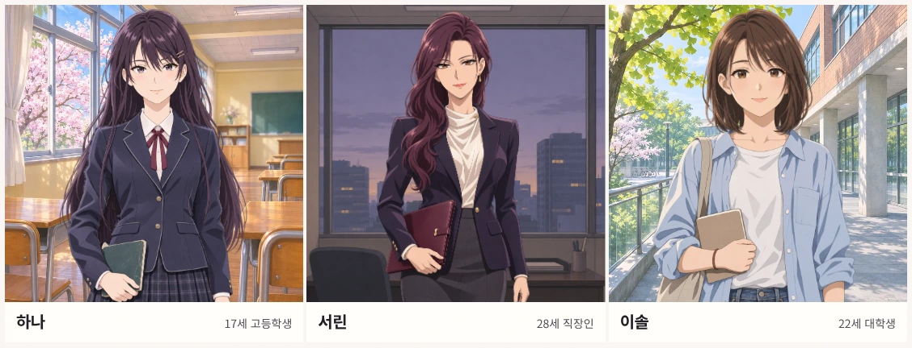

# 대화 캐릭터

**개인 비서 → 아바타 종류**에서 인물을 바꿀 수 있다. 캐릭터를 바꾸는 동안에도 메시지와 재생 중인 답변은 이어진다. 대화 모델과 목소리는 서비스·TTS 설정을 따른다. 성인 캐릭터와 대화하는 **가상 소개팅**에는 서린과 이솔이 등장한다. 하나를 선택한 채 소개팅으로 이동하면 서린이 나타나고, 캐릭터 선택을 바꾸지 않고 개인 비서로 돌아오면 하나가 다시 나타난다.

| 캐릭터 | 인물 디자인 |
|---|---|
| 하나 · 17세 고등학생 | 햇빛이 드는 교실. 회보랏빛 눈과 가슴 아래로 내려오는 짙은 자줏빛 긴 머리, 얇은 앞머리와 단정한 교복 리본으로 호기심 어린 인상을 냈다. |
| 서린 · 28세 직장인 | 퇴근 무렵의 사무실. 짙은 자줏빛 긴 머리와 길게 올린 눈꼬리, 금빛 귀걸이, 아이보리 블라우스와 짙은색 재킷으로 자신감 있는 인상을 잡았다. |
| 이솔 · 22세 대학생 | 부드러운 빛이 드는 서가. 느슨한 옆머리 땋기, 세이지색 옷과 아이보리 니트의 질감, 품에 안은 책으로 포근한 인상을 냈다. |

## 움직임 보기

[하나의 한국어 내레이션 시연 · 소리 있는 MP4](avatar-narration.mp4) · [서린의 표정 비교](seorin-character.md)

- **표정·동작 미리보기 → 내레이션 미리듣기**에서 한국어 샘플을 재생할 수 있다. 창가 이야기를 꺼낼 때 손으로 한 번 가리키고, 입술은 뒤이은 문장과 쉼까지 따라간다. 대화와 같은 플레이어가 소리를 분석한다. 마이크를 켜거나 새 답변이 시작되거나 캐릭터를 바꾸면 샘플이 멈춘다.
- 문장의 첫소리와 억양이 강해지는 순간에 눈썹과 고개가 작게 반응한다. 음량과 음색은 입의 높이·폭을 정한다. 문장 사이에 쉬면 입은 닫히고, 고개와 어깨의 움직임은 서로 다른 속도로 가라앉는다.
- 캐릭터 안에서 마우스 포인터를 좌우로 옮기면 홍채가 먼저 따라간다. 고개와 몸통은 조금 늦게 움직이고, 하나의 앞머리와 양옆의 긴 머리카락은 뿌리를 중심으로 흔들리다 멈춘다.
- **인사하기**와 **가리켜 설명하기**로 어깨에서 팔을 들어 손목까지 이어지는 동작을 볼 수 있다. 운영체제의 **동작 줄이기**에서는 표정과 손 모양, 음성에 맞춘 입술 움직임으로 말하는 상태를 확인할 수 있다.

### 내레이션 참고

- Live2D가 공개한 모모세 히요리 영상과 버튜버 에밀리아나가 소개한 VSeeFace 표정 추적 튜토리얼은 제작사·제작자가 연결한 YouTube 자료다. [히요리 공식 소개와 영상](https://www.live2d.com/learn/sample/momose-hiyori-video/) · [에밀리아나의 표정 추적 튜토리얼](https://www.youtube.com/watch?v=-Y2JyGLxuyo)
- 실제 움직임의 타이밍은 Project AIRI 제작팀이 공개한 음성 대화 시연에서 확인했다. 1분 1초대에는 입이 짧게 여러 차례 열리는 사이 고개는 한 번에 천천히 기울기를 푼다. 1분 3.72초부터 약 1초간 소리가 쉴 때는 입이 작게 다물린 채 눈이 한 번 깜박인다. 앱에서도 발음, 시선, 자세를 각각 다른 시간 간격으로 처리했다. [AIRI 제작팀의 시연 영상](https://github.com/moeru-ai/airi-docs/blob/6317834c5491589e7afc094878e911fee8636727/content/en/blog/DevLog-2025.03.20/assets/airi-demo.mp4)
- 미리듣기 음원은 이 프로젝트에서 쓴 두 문장을 eSpeak NG의 한국어 합성 음성으로 읽어 제작했다. 실제 대화에는 사용자가 설정한 TTS의 응답 음성이 들어간다.

## 작화 참고

작품 속 인물의 얼굴이 말을 하거나 시선을 바꿀 때 어느 선이 움직이는지 살펴봤다. 앱에 쓰는 세 인물의 원화는 이 프로젝트용으로 새로 생성했다. 홍채와 눈꺼풀, 눈썹, 다문 입술을 각 원화에서 분리하고 코와 턱은 원래 위치에 두었다. 아래 링크는 그림을 실제로 확인한 공개 자료다.

- 《빙과》의 치탄다 에루는 입 높이 아래에서 볼 선이 둥글게 모이고 윗눈꺼풀이 홍채 위쪽을 덮는다. 표정이 바뀔 때 코끝과 턱의 간격은 유지된다. 하나의 눈을 깜박일 때도 원화의 위·아래 눈꺼풀이 만나는 위치를 기준으로 삼았다. [치탄다의 정면 표정](https://github.com/r-anime/comment-face-assets/blob/9151e5e4373413e4c82ddd3533c4ae5c2f3efbd0/preview/active/curious.gif) · [눈꺼풀과 입이 달라지는 장면](https://github.com/r-anime/comment-face-assets/blob/9151e5e4373413e4c82ddd3533c4ae5c2f3efbd0/preview/active/wow-really.png)
- 《플라잉 위치》의 코와타 마코토가 눈을 감고 웃는 장면에서는 짧고 굵기가 달라지는 두 곡선만으로 눈이 감겼음을 보여 준다. 턱은 둥근 U자에 가깝고, 이 크기에서는 코의 선이 생략되어 두 톤으로 벌어진 입이 먼저 읽힌다. 하나의 깜박임도 자기 눈매에서 따온 닫힌 눈꺼풀 선으로 마무리한다. [마코토가 눈을 감고 웃는 장면](https://github.com/r-anime/comment-face-assets/blob/9151e5e4373413e4c82ddd3533c4ae5c2f3efbd0/source/static/comfy/original/comfy.png)
- 공무원이 주인공인 《서번트×서비스》의 야마가미 루시는 옆 볼에서 입가를 지나 턱까지 한 곡선이 이어진다. 고개를 기울이면 벌어진 입도 같은 각도를 따른다. 서린은 한쪽이 살짝 올라간 원래 입술 선을 기준으로 입이 열리도록 했다. [루시와 동료들의 작품 그림](https://github.com/BengaluruAnimeClub/bac-website-2.0/blob/e22222fcd11894c0eaf5e110056fb559f7bc9c65/public/images/blog/anime-spotlight-may25/servant-service.webp)
- 대학생의 표정은 《손끝과 연연》의 이토세 유키를 참고했다. 고개를 기울였을 때 가까운 볼에서 턱까지 선이 끊김 없이 좁아지고, 작은 코끝과 짧게 벌어진 입도 같은 방향을 따른다. 이솔의 눈과 입은 비스듬히 그린 원화에서 각각의 좌표와 각도를 측정했다. [유키의 표정 클로즈업](https://github.com/alifaputrinasrulloh-cell/yubisaki-to-renren/blob/4cef6ee594ed12f367601855106cf8d2f7857b40/scene1.jpeg)

기본 캐릭터는 브라우저의 SVG에서 원화와 표정·제스처 레이어를 합성한다. 개인 Cubism 모델을 사용할 때는 해당 모델의 표정과 모션을 대화 신호에 연결할 수 있다. [Live2D 모델 연결 안내](../live2d-asset-handoff.md)
