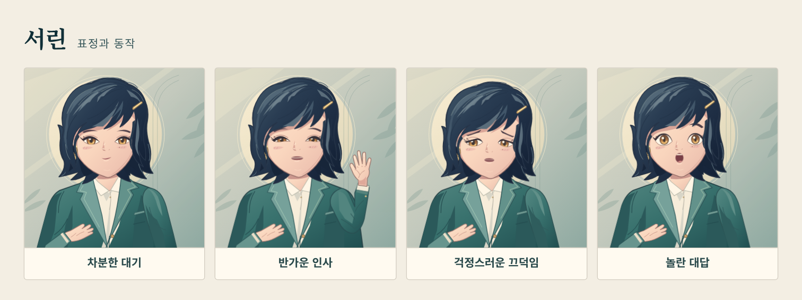

# 서린 캐릭터 가이드

서린은 상대의 말을 차분히 듣는 26세 여성 비서다. 짙은 남색 단발 한쪽을 금빛 머리핀으로 고정하고, 호박색 눈과 청록색 재킷, 아이보리 블라우스로 얼굴과 옷의 색을 구분한다. 재킷의 어깨선과 깃이 보이는 상반신 구도로 성인의 업무 복장을 표현한다. 작은 화면에서도 눈썹과 입이 읽히도록 앞머리가 표정을 가리지 않게 한다.

## 표정과 움직임

| 대화 신호 | 그림과 동작 |
|---|---|
| 차분함 · 기쁨 | 차분할 때는 눈과 입꼬리에 힘을 뺀다. 기쁠 때는 눈가와 입꼬리를 함께 올려 소리를 꺼도 미소가 보이게 한다. |
| 걱정 · 놀람 | 걱정할 때는 눈썹 안쪽을 들어 올린다. 놀랄 때는 눈을 크게 떠 두 표정이 작은 화면에서도 구별되게 한다. |
| 끄덕임 · 인사 | 끄덕일 때는 고개, 인사할 때는 손이 움직임의 중심이다. 제스처 도중에도 눈과 입은 답변에 계속 반응한다. |
| 대기 | 눈 깜박임과 가벼운 호흡으로 기다리는 모습을 표현한다. 동작 줄이기 설정에서는 반복 움직임을 멈추고 정적인 표정과 상태 문구로 대화 상태를 전한다. |

음성 재생 중에는 소리의 크기(RMS)를 입이 벌어지는 정도에 반영한다. 비슷한 음량에서도 소리가 상대적으로 밝거나 어두운 정도에 따라 입의 가로 모양을 조금 달리할 수 있다. 두 신호는 발화의 느낌을 표현하며 음소를 판별하지 않는다. 무음 구간과 재생 종료·취소 뒤에는 말하는 입모양을 풀어 원래 표정으로 돌아간다.

앱을 연결하면 기본 아바타로 서린이 나타난다. 텍스트 대화만 켜도 답변에 따라 표정과 제스처가 바뀐다. Windows에서 MeloTTS 워커와 토큰을 설정한 뒤 `.\scripts\start.ps1 -Provider demo -Voice`로 실행하면 데모 답변의 음성으로 입모양도 확인할 수 있다. [실행 안내](../../README.md)

## 구현과 참고 모델

기본 서린은 브라우저가 직접 그리는 오리지널 SVG다. 공식 샘플에서는 눈과 입을 독립적으로 움직이는 구조를 참고했으며, 샘플 그림·텍스처·모델 파일을 서린에 사용하지 않았다.

- 인물 연출에서는 20대 캐릭터 두 명을 비교했다. 20세 가상 가수 메구리네 루카는 팬 프로필에서 차분한 보컬리스트로 소개된다. 애니메이션 《어그레시브 레츠코》의 레츠코는 25세 직장인으로, 일할 때 억누른 감정을 노래로 강하게 표현한다. 서린은 상대의 말을 들을 때 어깨와 손을 편하게 두고, 직접 대답할 때 눈썹과 입, 인사하는 손에 힘을 주도록 설계했다. [루카 팬 프로필](https://github.com/ronanpjr/web2-mikuPlayer/blob/e55b5200a881d9234f364b7a9450dfef48116d79/src/pages/VocaloidProfilePage.js#L35-L53) · [레츠코 작품 소개 · MyAnimeList 인용](https://github.com/htron-dev/baka-db/blob/cb6e907a5c53113275da271631698cd3b35c9589/catalog/aggressive-retsuko/en-US_aggressive-retsuko.md#sinopse)
- 히요리(Hiyori)는 눈 깜박임에 `ParamEyeLOpen`과 `ParamEyeROpen`, 립싱크에 `ParamMouthOpenY`를 지정한다. 표정 데이터에는 입술 모양용 `ParamMouthForm`도 있어 입의 형태와 벌어짐을 따로 설계할 때 참고할 수 있다. [모델 설정](https://github.com/Live2D/CubismWebSamples/blob/b1de66b0b1f1cb881d95fb6158622aeb6a2827bd/Samples/Resources/Hiyori/Hiyori.model3.json) · [파라미터 목록](https://github.com/Live2D/CubismWebSamples/blob/b1de66b0b1f1cb881d95fb6158622aeb6a2827bd/Samples/Resources/Hiyori/Hiyori.cdi3.json)
- 마오(Mao)는 같은 눈 파라미터를 쓰지만 립싱크에는 `ParamA`를 지정한다. Cubism 모델을 연결할 때는 해당 모델의 `.model3.json`에 선언된 `LipSync` 그룹을 읽어야 한다. [모델 설정](https://github.com/Live2D/CubismWebSamples/blob/b1de66b0b1f1cb881d95fb6158622aeb6a2827bd/Samples/Resources/Mao/Mao.model3.json) · [공식 샘플의 립싱크 연결 코드](https://github.com/Live2D/CubismWebSamples/blob/b1de66b0b1f1cb881d95fb6158622aeb6a2827bd/Samples/TypeScript/Demo/src/lappmodel.ts#L399-L415)

선택형 Live2D 화면에는 사용권을 확보한 모델, Cubism Core·Framework와 렌더링 어댑터가 필요하다. 공식 샘플에도 Core 라이선스, 소재 라이선스와 모델별 이용 조건이 별도로 적용된다. [공식 저장소의 라이선스 안내](https://github.com/Live2D/CubismWebSamples/blob/b1de66b0b1f1cb881d95fb6158622aeb6a2827bd/LICENSE.md) · [이 앱의 Live2D 자산 연결 안내](../live2d-asset-handoff.md)
